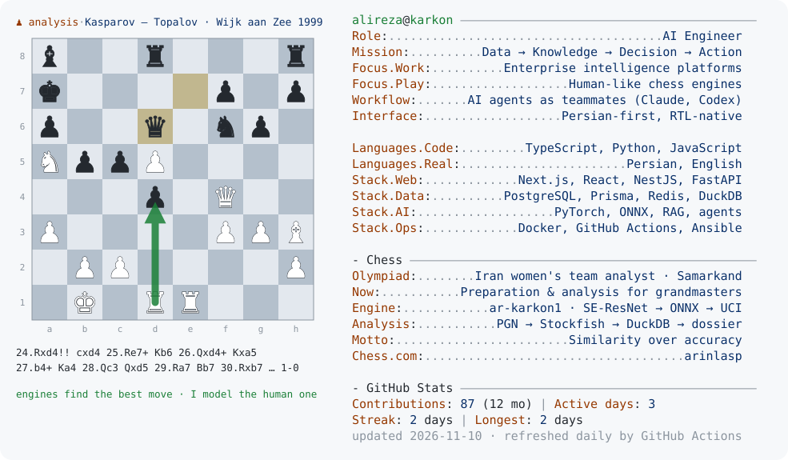

<a href="https://github.com/ar-karkon">
  <picture>
    <source media="(prefers-color-scheme: dark)" srcset="dark_mode.svg">
    
  </picture>
</a>

### I teach machines to think like people — in organizations, and on 64 squares.

**Enterprise intelligence.** I build Persian-first platforms that connect an organization's people, data and systems, and turn them into decisions: connectors to existing databases and services, a knowledge vault with semantic search, RAG assistants, and AI agents that take on real work. The rule I design by: *the system brings the evidence, a person makes the call.*

**Chess analysis and human-like chess AI.** At the Chess Olympiad in Samarkand I worked as an analyst for Iran's women's national team, under the team captain, and today I do preparation and analysis for several grandmasters. Most engines chase the best move; at the board, what matters is the move *your opponent* will actually play. So I build engines that play a specific person's move — trained on their games, measured by how often they choose what that player would choose. Same rule, different board: *similarity over accuracy.*

---

### What I've built

**Organizations**

- **Enterprise intelligence platform** — TypeScript monorepo (Next.js, Fastify, BullMQ workers): connectors → markdown knowledge vault with link graph and semantic search → risk analysis and decision support → meetings turned into tasks → AI agents you can delegate to.
- **Public-sector decision-support MVP** — Next.js + NestJS + a FastAPI AI orchestrator. Tasks → reports → manager approval → deterministic KPIs → dashboards, with permission-scoped, evidence-grounded AI.
- **Personnel evaluation engine** — an HR Excel model rebuilt as a tested calculation engine, with immutable records, evidence trails and role-based access, designed around ISO 10667 and ISO 30414.
- **After-sales platform for car dealerships** — customer app (OTP login, booking, live repair status), dealer CRM with workshop scheduling, and an operator console.
- **Multi-tenant AI assistant** — FastAPI with SSE streaming; every organization gets its own knowledge base (RAG), history and keys.
- **Infrastructure manager** — SSH-only, allowlisted server management with monitoring and Telegram alerting, provisioned with Ansible.

**Chess**

- **Elite preparation** — analyst for Iran's women's national team at the Chess Olympiad in Samarkand, working under the team captain; for the past year, preparation and opponent analysis for grandmasters.
- **`ar-karkon1`, a personal neural engine** — a PyTorch residual policy network with squeeze-and-excitation blocks, trained from one player's PGN, exported to ONNX and served over UCI so it plays inside ChessBase.
- **Player analyst** — PGN → Stockfish → DuckDB → two dossiers: a short one for the player, a full one for the captain with sample sizes and confidence intervals.
- **Bot-brain profiles and benchmarks** — opening book, error model and endgame habits extracted from real games, then tested on unseen games: how often does the bot play the player's move, and when it doesn't, is its move worse or just different?
- **Per-player Maia fine-tuning** (in progress) on top of a Maia data and training pipeline.
- **Chess training app** — React + Stockfish (WASM) analysis with eval bar, blunder and missed-chance detection, and 3.5M Lichess puzzles.

Most of this lives in private repositories because it's client or product work. I'm happy to walk through any of it.

---

### How I work

- **AI agents are teammates.** Projects start with a spec, a status file and agent rules (`AGENTS.md`, `CLAUDE.md`). Claude Code and Codex each own modules of the monorepo; I own the architecture, the contracts and the final review.
- **Evidence before decisions.** Scores, KPIs and recommendations always show where they came from. Low data blocks a final decision instead of faking one.
- **Persian first.** RTL by default, Persian typography done properly, English as a second language — not the other way around.
- **Ship it.** Docker, CI and deploy docs are part of the work, not an afterthought.

---

**علیرضا کارکن** — مهندس هوش مصنوعی. سامانه‌های هوش سازمانی می‌سازم که داده را به دانش، دانش را به تصمیم و تصمیم را به اقدام تبدیل می‌کنند. در شطرنج، آنالیزور تیم ملی بانوان ایران در المپیاد سمرقند (زیر نظر کاپیتان تیم) بودم و امروز برای چند استادبزرگ آماده‌سازی و آنالیز انجام می‌دهم. موتورهای شطرنجی هم می‌نویسم که به‌جای بهترین حرکت، حرکتِ یک بازیکن مشخص را بازی می‌کنند.

